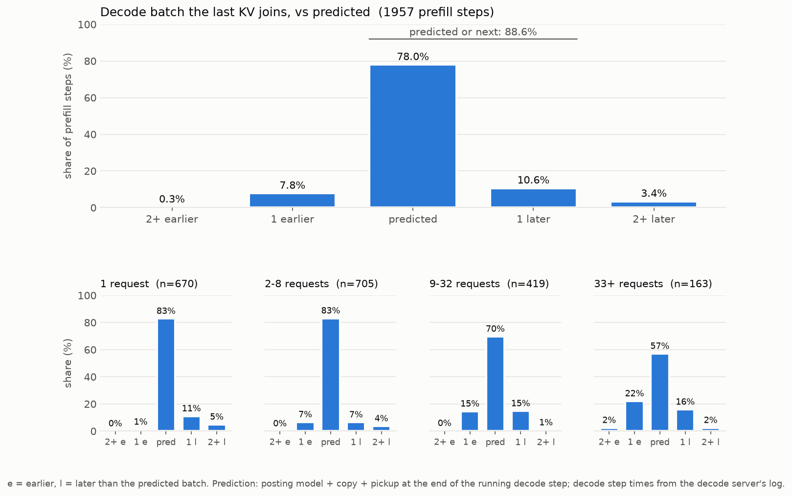

# PD KV transfer: which decode batch a request joins

How long after its prefill a request's KV cache reaches the decode server, as SGLang (fork 99f39f2b5) with NIXL over
NVLink does it, for gpt-oss-20b on the 4xA100 VM. Fitted on `results/gptoss-pd-xfer-default-nixl-20261105`: fork
defaults (page size 1, overlap scheduling), 334 probe batches under four loads (idle, prefill-2048, decode-32,
prefill-2048+decode-32), 1,957 prefill steps.

What is predicted: from the end of the prefill forward pass that computed a request's last chunk, until the decode
server picks up its KV, i.e. which decode batch it joins. Building and starting that batch (about 1 ms) would happen
anyway and is left out.

A prompt cut by the 8,192-token prefill budget runs in two steps. It counts only in the step that ran its last chunk:
it is part of that step's group, and its clock starts when that step ends. Its first chunk is just part of an
earlier prefill step.

## How the transfer happens

1. Handshake, before the prefill runs. The decode server allocates KV slots for the request and sends their
   addresses to the prefill server (ZMQ). The prefill server does not schedule the request before it has them. A full
   decode server delays this, which delays the prefill, not the transfer.
2. Prefill forward pass. The prompt's KV is written into the prefill GPU's KV pool.
3. Posting, prefill CPU. Once the step's outputs are ready, the scheduler loops over the step's requests and, for
   each, copies its slot indices to the CPU, then queues a one-sided NIXL WRITE of its KV, and one of its metadata
   (first output token), to the decode server. Each post takes about 1.9 ms. Posting uses no SMs.
4. Copy. The KV goes GPU to GPU over NVLink on the copy engines (UCX's GPU-IPC transport). The decode server's CPU and
   SMs are not involved. Each write delivers a notification when it completes.
5. Pickup, decode CPU. At the top of each scheduler loop iteration, the decode server reads the notifications. While it
   is running decode steps, an iteration lasts one decode step, so a KV that lands mid-step waits for the step to end.
   When idle, it is picked up at once. Steps started by the same prefill step's earlier requests count: they start
   decoding the moment they arrive.

Decode batches are scheduled one step at a time: `--num-continuous-decode-steps` is 1 and the decode server polls for
KVs every iteration (`--disaggregation-decode-polling-interval` 1).

## The model

For a group of N requests whose prefill finished in the same step, the time for the last one posted:

```
T = Posting + Copy + DecodeWait

Posting    = the selected regression below (0 for N = 1)
Copy       = about 1.5-2.5 ms (+ at most 0.05 ms per request of the group and 0.02 ms per MB)
DecodeWait = (end of the decode step running at R) + 2.0 ms - R   if the decode batch has any request at R
           = 0                                                     if it is empty
```

- R, the ready time, is the end of Posting + Copy.
- The 2.0 ms is the time from a decode step's end until the decode server's poll sees the KV.
- The decode step boundaries come from the decode side of a simulator. In this evaluation they are the decode
  server's logged step times (`--decode-log-interval 1`, `SGLANG_LOG_MS=1`).

The posting model, fitted on all the data, in ms. Variables:
- the migrating group: N, S (total tokens), M (longest prompt);
- the prefill step running after it: S_p, M_p (0 if none);
- the decode batch running when posting starts: N_d, S_d (total context).

```
Posting = -0.86 + 1.934 N + 9.76e-4 S - 1.39e-3 M
          - 2.34e-5 N*S + 1.16e-4 N*M - 2.71e-7 S*M + 3.14e-7 M^2
          + 4.63e-4 M_p + 2.06e-4 N*S_p          (prefill step running after)
          + 3.86e-7 S*S_d - 8.46e-5 M*N_d        (decode batch running during)
```

Fitting:
- Posting is fitted to relative error.
- The copy and pickup constants are a grid search on median absolute error.
- Everything is held out by set of prompt lengths, five folds. The posting terms are chosen within each training
  fold; the formula above is the choice on all the data.

## Results: predicted vs actual decode batch



| decode batch joined | share of prefill steps |
|---|---|
| the predicted one | 78.0% |
| the next one | 10.6% |
| predicted or next | 88.6% |
| one earlier | 7.8% |
| 2+ earlier | 0.3% |
| 2+ later | 3.4% |

Without the 2.9% of steps with a slow copy (below): 80.3% the predicted batch, 91.2% predicted or next, 0.5% 2+ later.
With the posting time known (measured instead of modeled): 84.9% and 92.0%.

| requests in the group | steps | 2+ earlier | 1 earlier | predicted | next | 2+ later |
|---|---|---|---|---|---|---|
| 1 | 670 | 0% | 1% | 83% | 11% | 5% |
| 2-8 | 705 | 0% | 7% | 83% | 7% | 4% |
| 9-32 | 419 | 0% | 15% | 70% | 15% | 1% |
| 33+ | 163 | 2% | 22% | 57% | 16% | 2% |

Counting a cut prompt at its first chunk instead, as an earlier version of this page did, gave 76.3% and 86.9%.
The 43 steps that now hold a cut prompt land in the predicted batch 40 times.

## Choosing the posting model

The posting time (first end to last end, groups of 2+ requests) was fitted with the paper's four regressions
(linear, degree 2, degree 2 + sum l^2, backward-selected) on nine variables (N, S, M; N_p, S_p, M_p; N_d, S_d, M_d),
with scikit-learn's random forest and gradient boosting (default settings) on the same variables, and with a
component model (1.93 ms per request after the first, plus terms for tokens posted and for decode and prefill running
alongside). Each was plugged into the copy and pickup model above and scored on which decode batch the last KV joins,
over all 1,957 steps.

| posting model | posting error, median | p90 | 2+ earlier | 1 earlier | predicted | next | 2+ later | predicted or next | without slow copies |
|---|---|---|---|---|---|---|---|---|---|
| component model | 2.02 ms | 11.7 ms | 1.7% | 13.7% | 68.5% | 12.3% | 3.7% | 80.8% | 70.5% / 83.2% |
| linear (10 terms) | 3.74 ms | 11.0 ms | 1.2% | 17.0% | 69.1% | 9.2% | 3.5% | 78.3% | 71.2% / 80.7% |
| degree 2 (55 terms) | 1.91 ms | 8.1 ms | 0.3% | 10.4% | 76.0% | 9.9% | 3.5% | 85.9% | 78.2% / 88.4% |
| degree 2 + sum l^2 (57 terms) | 1.93 ms | 8.0 ms | 0.3% | 8.2% | 77.2% | 10.8% | 3.6% | 88.0% | 79.5% / 90.6% |
| **selected (12 terms)** | 1.76 ms | 8.0 ms | 0.3% | 7.8% | **78.0%** | 10.6% | 3.4% | **88.6%** | **80.3% / 91.2%** |
| random forest | **1.65 ms** | 8.6 ms | 0.2% | 7.9% | 77.1% | 11.1% | 3.7% | 88.2% | 79.3% / 90.8% |
| gradient boosting | 1.92 ms | 10.3 ms | 0.7% | 9.9% | 76.0% | 9.7% | 3.7% | 85.7% | 78.2% / 88.1% |

"Without slow copies" is predicted / predicted or next. The random forest has the smallest posting error, but the
selected regression hits the batch slightly more often and has readable terms. The component model over-predicts
posting for groups of 33+ by 2.2 ms (median); the selected regression by -0.15 ms. That is why big groups now land
early much less often (33+: 49% earlier with the component model, 25% with the selected one).

## Slow copies

On 2.9% of steps (57) the last KV arrives more than 50 ms after its post, median 105 ms, where a copy normally takes
2-4 ms. What the data shows:
- **It is the copy.** The prefill server's own transfer timer also reads about 100 ms on these steps, and the decode
  server picks the KV up within one decode step of that. The decode server keeps stepping normally meanwhile.
- **It is not the handshake.** The decode server had the slots ready 170-570 ms before the prefill ended.
- **It needs a busy decode server.** 56 of 57 are in the decode-32 loads; 98% have decode running at the post (56%
  of other steps). Slow share by load: idle 0%, prefill-2048 0.5%, decode-32 2.8%, prefill-2048+decode-32 10.5%.
- **It grows with prompt length.** With decode busy: under 1k tokens 1.3%, 1-4k 8.2%, 4k+ 24%.
- **Page size 64 cuts it 2-3x.** Same probes and loads (`results/gptoss-pd-xfer-page64-nixl-20261105`): 1.4% of
  steps overall, 3.6% in prefill-2048+decode-32, 13% at 4k+ with decode busy.

The likely cause: at page size 1, a busy decode server's free KV slots are scattered, since running requests keep
finishing and freeing single tokens. A long prompt's slots are then far from contiguous, and the NIXL write becomes
many small pieces instead of a few large ones. Larger pages keep the pieces larger. This is not confirmed: the runs do
not log how many pieces a write had, and page 64 does not remove all of it. Confirming it needs the descriptor count
per write (NIXL/UCX logging) in a new run.

## Reproducing

```
pip install numpy scikit-learn matplotlib
src/pd_transfer/run.sh results/gptoss-pd-xfer-default-nixl-20261105 WORK_DIR results/pd-transfer-model/decode_batch_offset.png
```

The data is `results/gptoss-pd-xfer-default-nixl-20261105`, which `src/pd_load.py` produced with `--plan
src/pd_load_sweep.json --scenarios idle,prefill-2048,decode-32,prefill-2048+decode-32`. `run.sh` writes the tables
(`barometer.md`, `barometer.json`, here as of this page) and the working pickles to WORK_DIR. It takes about 10
minutes.

| file in `src/pd_transfer/` | what it does |
|---|---|
| `stepmodels.py` | the clean run's prefill step model, for the prefill step running after a posting one |
| `logs.py` | reads the servers' step lines with millisecond timestamps |
| `steps.py` | replays the prefill log into steps; cut prompts go to the step of their last chunk |
| `component.py` | the component posting model and the step variables |
| `posting.py` | the four regressions and two trees for the posting time, held out |
| `score.py` | copy and pickup fit, and the predicted decode batch, for one posting model |
| `table.py`, `figure.py` | the barometer tables and the figure |
